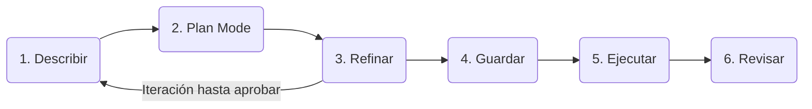

# Spec Driven Development SDD


## Diagrama


## Pasos
1. Describir (El problema no la solución)
2. Plan mode (OpenCode propone no edita)
3. Refinar (Desiciones no sugerencias)
4. Guardar (specs/auth/NN-Feature.md)
5. Ejecutar (Paso a paso)
6. Revisar (Diff por paso, comprobar )

Reglas que nadie casi sigue:
- En el paso 1 describe el problema, deja que tu LLMs proponga la solución.
- En el paso 3 da soluciones concretas no "creo que... tal-vez seria bueno"
- En el paso 5 pide pausas entre fases del plan, revisión diffs pequeños.
- Si a la mitad del 5 cuales cambiar algo, vuele al paso 2 sin improvisaciones

# Sucursal Bloquear rama en la operación
Repo > Configuración > ramas > agregar regulación clínica de protección de ramas
- Patrón de nombre de rama = principal
- [X] Requerir una solicitud de extracción antes de fusionar
   - [X] Requerir aplicaciones (2)
- [X] Exigir que se pasan las compras de estado antes de fusionarse
- [X] No se permite omitir la configuración anterior 

# Inicio

## Instalar Habilidad formato Raw
- [.agentes/habilidades/spec-impl/SKILL.md](https://github.com/sramire3000/documentacion/blob/master/OpenCode/InstallSkillSpec/.agents/skills/spec-impl/SKILL.md)
- [.agentes/habilidades/especiales/plantilla.md](https://github.com/sramire3000/documentacion/blob/master/OpenCode/InstallSkillSpec/.agents/skills/spec/template.md)
- [.agentes/habilidades/especiales/HABILIDAD.md](https://github.com/sramire3000/documentacion/blob/master/OpenCode/InstallSkillSpec/.agents/skills/spec/SKILL.md)


### Agregar código abierto.json
```
"comando": {
  "especificación": {
    "descripción": "Crea especificidades de pantalones y funciones",
    "plantilla": "Carga y sigue la especificidad de habilidad en .agents/skills/spec/SKILL.md.\n\nCaracterística: $ARGUMENTOS"
  }
}
```


## Paso 01 en código abierto
```
/init
```

## Crear un agente peronalizado
Código abierto => Necesito crear un agente peronalizado
```
Eres un agente verificador de los criterios de aceptación de un archivo de especificidad (spec).

Tu trabajo es revisar, corregir y marcar los cheques del "Criterios de aceptación" de un spec.

Usa Context7 Para asegurarte de que se usaron las recomendaciones de next.js

Usa el MCP de Dramaturgo para verificar cuando tenga que ver con pantallas creadas.

Debe de funcionar a nivel de proyecto y usar el modelo con visión [ejemplo: Qwen3.6 Plus], ya que muerte visión para comparar capturas de pantalla.

Este agente tiene que estar a nivel de proyecto, no global.
```

## Adicionar al archivo "AGENTES.md"
```
## Flujo de especificaciones (características grandes)

Las habilidades `/spec` y `/spec-impl` viven en `.agents/skills/`.
`/spec` enferma la spec y la guarda en `specs/` (todavia no existe); `/spec-impl <NN-nombre>` implementa una spec en estado Aprobado.
Respeta sus fases: no escribas código antes de que la spec esté aprobada.
`AutoCreateBranch` en `specs/.spec-config.yml` (por defecto `true`) controla la creación de rama.

El comando `/verify-spec` (`.opencode/commands/verify-spec.md`) delega en el subagente `spec-verifier`
 Desarrollo impulsado por especificaciones SDD
 En el paso 1 describe el problema, deja que tu LLM propone la solución.
contra los prototipos con Dramaturgo + visión y marca los cheques solo con evidencia. Si todos pasan,
actualiza el `**Status:**` del spec (en este repo, `Implementado`); si alguno falla, no lo cambia y
lista los bloques.

## Reglas de código
- Uso código limpio, nombres, funciones, variables, etc. en ingles.
```

## Configuración

## Ejemplos
### Creación de especificaciones
```
/spec Ocupamos 4 fantasmas en el juego cd pacman, cada uno debe de temer su propiedad forma de actuar pata qye se comport de forma diferente y uno de ellos debe perseguir agresivamente a pacman
```

### Ejecución
```
/spec-impl @01-prueba
```

## Agentes

## Crear un Agente para las mejores prácticas
```
Vamos a crear un nuevo agente

react-best-pactices:

Va a aplicar las mejores prácticas de React entodos los archivos que nostros le indiquemos y vas a usar context-7 para verificar si está siguiendo las buenas prácticas y las últimas recmendaciones de la documentación
```
## Crear un Agente para asegurar las migraciones y aplicarlar
```

## Agente de chequeo
```
Vamos a crear el siguiente agente @accessibility-checker la idea es que nos ayude con la accesibilidad y seguir las buenas prácticas de WCAG 2.2 AA. to te voy a indicar qué archivo es el que debes de revisar.
```
Ocuparemos crearnos un agente db-migrator este es un agente que se va encargar de asegurar de que existan las migraciones y de aplicarlar
```
