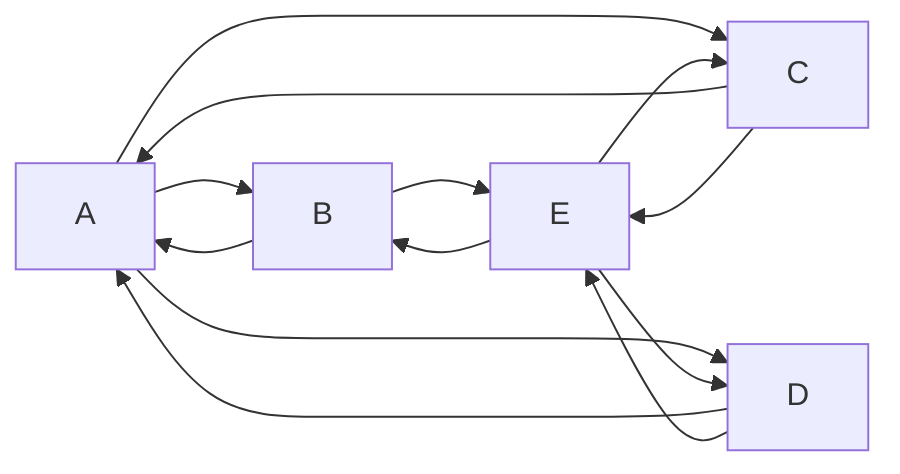

# COMANDOS DE GIT

# Download
-[Download Windows](https://git-scm.com/)

## Version de git
```
git --version
```

## Git config
```
git config --global user.name "John Doe"
git config --global user.email johndoe@example.com
```

## Guarda las credenciales en el gestor de windows
```
git config --global credential.helper manager
```

## Guarda las credenciales en el gestor de linnux
```
git config --global credential.helper manager-core
```


## TRABAJAR CON RAMAS

### Muestra la rama donde estoy parado
```
git branch
```

### Clona la rama apartir de donde estoy parado y crea la nueva
```
git branch [rama_nueva]
git push -u origin ramita1 
````

### Cambiar el nombre a una rama
```
git branch -m [rama_old] [rama_new]
```

### cambiarse de rama
```
git checkout [nombre de la rama]
```

### Eliminar una rama
```
git branch -d [nombre de la rama]
```
### Hacer un merge entre ramas
```
# Ubicarse en la rama que va recibir los cambios
git checkout master

# Merge
git merge [ramaOrigen] [ramaDestino]

# Adicionar los cambios
git add .
git commit -m "Cambios de ramita1 => master"
git push
```

### Respaldo de rama
```
git archive --format zip --output respaldo_rama.zip nombre_de_tu_rama
```

###Crear un "Bundle" (El respaldo profesional de Git)
Si quieres un solo archivo que contenga absolutamente todo (todas las ramas, todos los commits y todo el historial) para poder restaurarlo después en otra computadora como un repositorio completo, lo ideal es usar un bundle.

Ejecuta esto en tu consola:
```
git bundle create respaldo_total.bundle --all
```

### Respaldar todas las ramas en archivos ZIP individuales 
PowerShell
```
git branch -r | ForEach-Object { 
    $branch = $_.Trim().Replace("origin/", ""); 
    if ($branch -notmatch "HEAD") {
        git archive --format zip --output "backup_$($branch.Replace('/', '_')).zip" "origin/$branch"
        Write-Host "Respaldada rama: $branch"
    }
}
```

Linux
```
for branch in $(git branch -r | grep -v 'HEAD'); do
    # Limpiamos el nombre de la rama (quitamos 'origin/')
    clean_name=$(echo $branch | sed 's/origin\///')
    
    # Reemplazamos barras inclinadas por guiones bajos para el nombre del archivo
    file_name=$(echo $clean_name | tr '/' '_')
    
    echo "Respaldando rama: $clean_name..."
    git archive --format zip --output "backup_${file_name}.zip" "$branch"
done
```

## REPOSITORIO 

### …or create a new repository on the command line
```
echo "# prueba" >> README.md
git init
git add README.md
git commit -m "first commit"
git branch -M master
git remote add origin [url_git]
git push -u origin master
```

### Clonar repo
|                 Comando               |           Descripción                 |
|---------------------------------------|---------------------------------------|
|git clone [url_git]                    | Clonar un repositorio                 |
|git clone -b [nombre_branch] [url_git] | Clonar un repositorio rama especifico |               |

…or push an existing repository from the command line
```
git remote add origin [url_git]
git branch -M master
git push -u origin master
```

## COMANDOS

|             Comando             |           Descripción                              |
|---------------------------------|----------------------------------------------------|
|git init                         | Inicaliza un repositorio                           |
|git status                       | Estado del repo local                              |
|git add .                        | Sube todos los archivos repo local                 |
|git comit -m "Texto del cambio"  | Comitea los cambios                                |
|git push                         | Guarda los cambios                                 |
|git pull origin master           | Actualiza los cambios de git alocal                |
|git reset --hard origin/master   | Actualiza la rama a ultimo estado(pierden cambios) |
|git diff master [tu_branch_trabajo]   | busca las diferencias |


## SOLUCIÓN DE CONFLICTOS

### Resolver un conflicto pero quieres que tu cambio prevalezca totalmente tu cambio "README.md"
```
# Traer los cambios del servidor (Fetch)
git fetch origin

# Sobrescribir el archivo con tu versión (Checkout)
git checkout --ours README.md

# Luego marcas el conflicto como resuelto
git add README.md
git commit -m "Solucionando conflicto: prevalece mi versión de README.md"

# Subir tus cambios cambia "tu-rama" por tu rama
git push origin tu-rama --force
```

### Resolver el conflicto pero quieres hacer un merge
```
# Guardar cambios en local
git add README.md
git commit -m "Mis cambios temporales antes del merge"

# Sincroniza tu repositorio
git fetch origin

# Intenta el Merge
git merge origin/master

#. Resuelve el conflicto manualmente
Como ambos tocaron el mismo archivo (README.md), Git se detendrá y te dirá: "Automatic merge failed; fix conflicts and then commit the result".

Abre el archivo README.md en tu editor (puedes usar nano que recién instalamos). Verás unas marcas extrañas que dividen ambos cambios:

<<<<<<< HEAD: Todo lo que esté debajo de esto es tu cambio local.

=======: Esta es la línea divisoria.

>>>>>>> origin/master: Todo lo que esté arriba de esto es el cambio que estaba en GitHub.

Lo que debes hacer:

Borra las marcas (<<<<, ====, >>>>).

Acomoda el texto para que ambos cambios queden como tú quieras (uno arriba del otro, o mezclados).

Guarda el archivo.


# Finaliza el proceso
git add README.md
git commit -m "Merge de cambios en README: integrando ambas versiones"
git push origin master
```

## TOKEN'S

### crear un Token en tu cuenta
-[generate Token](https://github.com/settings/tokens)
```
Note          : nombre_token
Expiration    : No Expiration
Select Scopes : repo mark
```

### Configurar por primera vez
```
git init
git config user.name "nombre usuario git"
git config user.email "email"
git config user. password [token_gerado]
```

### Configurar si ya existe
```
git remote add origin [url_git]
```

## VIEW CONFIGURATION

### Ver toda la configuración activa
```
git config --list
```

### Ver el origen de cada configuración
```
git config --list --show-origin
```

### Ver niveles específicos
```
# Local (solo del proyecto actual):
git config --list --local

# Global (de tu usuario de Windows):
git config --list --global

# System (de toda la máquina):
git config --list --system
```

### Consultar un valor específico
```
git config user.email
```

### Tip Pro: Editar la configuración
```
git config --global --edit
```



-[Stack Edit](https://stackedit.io/app#)

# Trabajar con git

## Proteger rama "main"
Para proteger la rama main en un repositorio de GitHub y asegurarte de que nadie pueda hacer push directo (forzando a que cualquier cambio pase obligatoriamente por un Pull Request y cumpla con las revisiones que elijas), debes configurar una Branch Protection Rule (Regla de protección de rama).

Sigue estos pasos desde la interfaz web de GitHub:

## Pasos para configurar la protección de la rama main
Entra a tu repositorio en GitHub.

1. En la barra de pestañas superior, haz clic en Settings (Configuración). (Nota: Debes tener permisos de Administrador o Owner del repositorio).
2. En el menú lateral izquierdo, busca la sección Code and automation y haz clic en Branches.
3. En la sección Branch protection rules, haz clic en el botón verde Add branch protection rule.

### Configuración de la regla
Una vez dentro del formulario de creación de reglas, configura los siguientes parámetros clave:

1. Nombre de la rama
```
main
```

2. Requerir Pull Request antes de fusionar (Merge)
Marca la casilla Require a pull request before merging.

Dentro de esta opción, te recomiendo marcar:

Require approvals (Requerir aprobaciones): Selecciona cuántas aprobaciones de otros colaboradores se necesitan antes de poder hacer el merge (por ejemplo, 1).

Dismiss stale pull request approvals when new commits are pushed (Opcional): Si alguien sube nuevos cambios a la rama del PR, borra las aprobaciones anteriores para obligar a una re-revisión.

Require review from Code Owners (Opcional): Si tienes un archivo CODEOWNERS, exige revisión de los dueños específicos del código.

3. Bloquear Push Directo (El objetivo principal)
Al activar el requisito de Pull Request, automáticamente se bloquea el push directo (git push origin main) para todos los usuarios que no sean administradores con permisos de bypass.

4. Opciones adicionales recomendadas (Buenas prácticas)
Require status checks to pass before merging: Si usas integración continua (CI/CD) como GitHub Actions, tests automatizados o linters, marca esta opción para que el PR no se pueda fusionar si las pruebas fallan.

Require linear history: Evita commits de tipo "merge" innecesarios, manteniendo un historial limpio basado en rebase o squash.

Do not allow bypassing the above settings: Marca esta casilla si quieres que incluso los administradores del repositorio tengan que pasar obligatoriamente por un Pull Request y no puedan saltarse las reglas.


## Actualizar la rama al estado original sin importar perder los cambios
```
git fetch origin
git reset --hard nombre-de-la-rama
git clean -fd
```

### Crear la rama y cambiarte a ella en un solo paso
```
git checkout -b nombre-de-la-rama
```

### Pasar a la Rama main y actualizar
```
git checkout main
git pull
```
